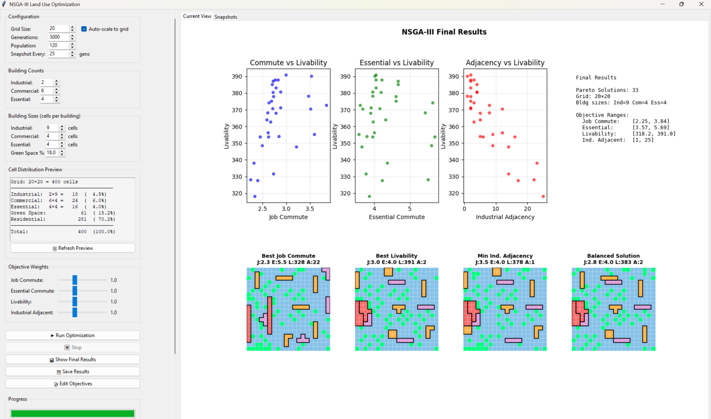
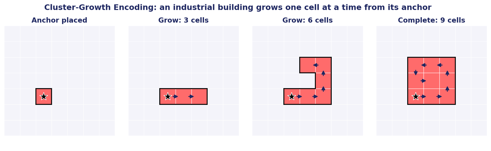
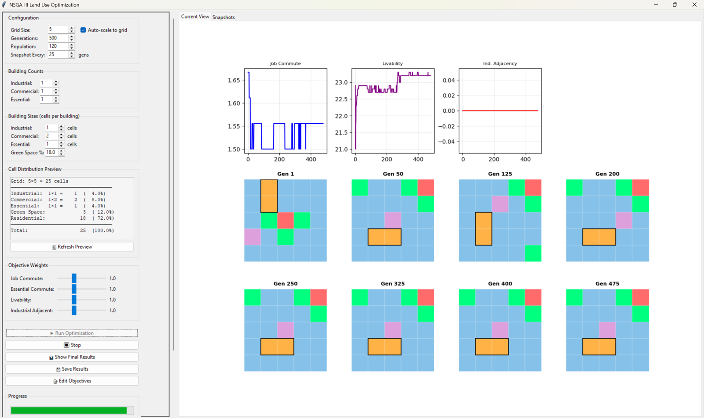

# Land Use Optimization with NSGA-III

My Senior Synthesis capstone in Applied Mathematics at Seattle University (March 2026, advised by Dr. Bahuaud).

The tool places five land use types (residential, green space, commercial, industrial, essential services) on a square grid and uses the NSGA-III genetic algorithm to find layouts that trade off four objectives:

1. Minimize the commute from homes to jobs
2. Minimize the commute from homes to essential services
3. Maximize livability (neighbor effects, e.g. green space next to housing)
4. Minimize industrial cells next to residential cells

There is no single best layout, so the result is a set of Pareto-optimal layouts to choose from.



## How it works

- Residential and green space cells are single cells. Commercial, industrial and essential buildings are multi-cell clusters.
- Each cluster is encoded as an anchor cell plus a sequence of growth directions, so the genetic operators change both where a building sits and its shape.
- Commute distances use taxicab distance to the nearest cell of the target type, not the cluster center.
- Building counts and sizes scale with the grid size, using the 20 x 20 grid as the baseline.
- Objective functions are vectorized with NumPy.
- Built on [pymoo](https://pymoo.org/) with custom sampling, crossover and mutation.



## Results

On a 20 x 20 grid, runs consistently reached livability scores within about 3% of the cluster-constrained maximum. Commute distance and industrial adjacency pull against each other, which shows up as the Pareto trade-off. Independent runs converged to similar fronts.

A 5 x 5 test case, with snapshots every 25 generations:



The full write-up is in [paper/Land_Use_Optimization_NSGA-III.pdf](paper/Land_Use_Optimization_NSGA-III.pdf).

## Running it

```
pip install -r requirements.txt
python nsga3_land_use.py                  # Tkinter GUI
python nsga3_land_use.py --cli 500 20     # command line: 500 generations, 20 x 20 grid
```

The GUI lets you set grid size, generations, population, building counts and sizes, and objective weights, and shows convergence and layout snapshots while it runs.

## Background

This project was inspired by Sicuaio et al. (2024), who applied NSGA-III to land use planning in Maputo, Mozambique. I added free-form building growth, nearest-cell distances and proportional grid scaling.

After graduating I applied the same optimizer to a real site in San Jose: [berryessa-urban-village-optimization](https://github.com/Kyler-Kasravi/berryessa-urban-village-optimization).
